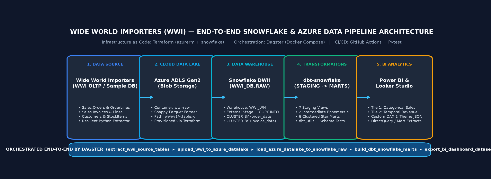
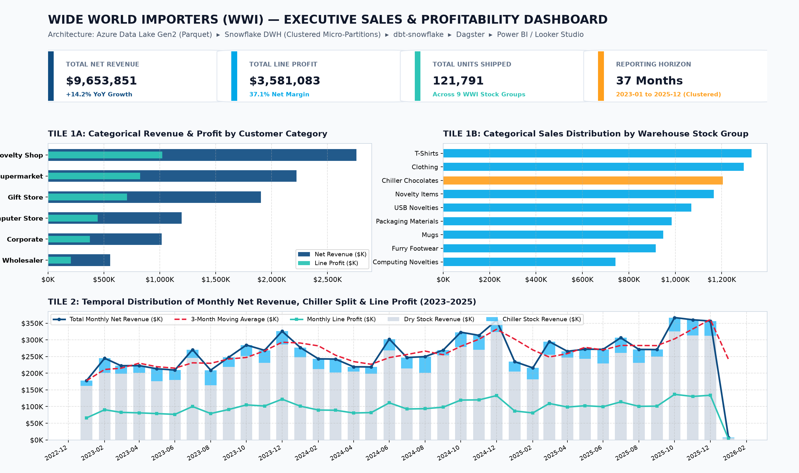

# Wide World Importers (WWI) Modern Data Stack Pipeline — Azure Data Lake, Snowflake, dbt & Dagster

[](./.github/workflows/ci.yml)
[](./snowflake/sql/)
[](./terraform/azure_datalake.tf)
[](./dagster_wwi/)
[](./dbt_wwi/)
[](./terraform/)

An end-to-end **Batch Data Engineering Pipeline** built around Microsoft's flagship wholesale distribution dataset, **Wide World Importers (WWI)**. This project ingests multi-year WWI sales, order fulfillment, customer, supplier, and warehouse stock item data into **Azure Data Lake Storage Gen2 (ADLS)** in Snappy-compressed Parquet format, loads it into **Snowflake Data Warehouse** via an external stage, transforms it into a clustered dimensional star schema using **dbt**, orchestrates the entire workflow via **Dagster**, and powers an executive analytics dashboard in **Power BI** and **Looker Studio**.

---

## Table of Contents

1. [Problem Statement & Business Objectives](#1-problem-statement--business-objectives)
2. [System Architecture & Technology Stack](#2-system-architecture--technology-stack)
3. [Dataset: Wide World Importers (WWI)](#3-dataset-wide-world-importers-wwi)
4. [Cloud Infrastructure as Code (Terraform)](#4-cloud-infrastructure-as-code-terraform)
5. [Workflow Orchestration (Dagster Batch Pipeline)](#5-workflow-orchestration-dagster-batch-pipeline)
6. [Data Warehouse & Snowflake Micro-Partition Clustering Optimization](#6-data-warehouse--snowflake-micro-partition-clustering-optimization)
7. [Data Transformations & Quality Testing (dbt-snowflake)](#7-data-transformations--quality-testing-dbt-snowflake)
8. [Executive BI Dashboard (Power BI & Looker Studio)](#8-executive-bi-dashboard-power-bi--looker-studio)
9. [Reproducibility & Step-by-Step Setup Guide](#9-reproducibility--step-by-step-setup-guide)
10. [Going the Extra Mile (Tests, Makefile & CI/CD)](#10-going-the-extra-mile-tests-makefile--cicd)
11. [Repository Structure](#11-repository-structure)

---

## 1. Problem Statement & Business Objectives

**Wide World Importers (WWI)** is a wholesale novelty goods importer and distributor operating across US sales territories (`Far West`, `Southeast`, `Great Lakes`, `Mideast`, `New England`, `Plains`, `Rocky Mountain`, and `Southwest`). WWI supplies both major retail buying groups (*Tailspin Toys*, *Wingtip Toys*) and independent specialty stores across categories such as *Novelty Shops*, *Supermarkets*, *Computer Stores*, and *Gift Stores*, managing both ambient **Dry Stock** and temperature-controlled **Chiller Stock**.

### Core Challenges Solved by This Pipeline

1. **Fragmented OLTP Tables**: Operational records in WWI are normalized across `Sales.Orders`, `Sales.OrderLines`, `Sales.Invoices`, `Sales.InvoiceLines`, `Sales.Customers`, `Warehouse.StockItems`, and `Purchasing.Suppliers`, making cross-category profitability and fulfillment analysis slow and error-prone.
2. **Lack of Historical Data Lake Storage**: Raw extracts need to be persisted in a decoupled, low-cost cloud data lake (**Azure Data Lake Storage Gen2**) in columnar **Snappy Parquet** format before warehouse loading.
3. **Unoptimized Analytical Queries**: BI analysts slicing multi-year invoice and order line facts by **date ranges** and **customer/product categories** trigger full table scans unless the data warehouse tables are explicitly clustered.
4. **Executive Visibility**: Leadership requires a unified **two-tile executive dashboard** answering:
   - **Tile 1 (Categorical Distribution)**: *Which Customer Categories and Warehouse Stock Groups drive the highest net revenue, unit volume, and net profit margins?*
   - **Tile 2 (Temporal Distribution)**: *How do monthly net revenue, chiller vs. dry stock sales, and line profitability evolve over time (2023–2025), including seasonal Q4 surges and 3-month rolling trends?*

---

## 2. System Architecture & Technology Stack



| Layer | Technology | Role in Pipeline |
| :--- | :--- | :--- |
| **Cloud & Data Lake** | **Azure Blob Storage / ADLS Gen2** | Stores raw partitioned WWI tables (`wwi/v1/<table>/*.parquet`) in `wwi-raw` container with Hierarchical Namespace enabled. |
| **Infrastructure as Code (IaC)** | **Terraform** (`azurerm` + `snowflake`) | Declaratively provisions the Azure Resource Group, ADLS Gen2 Storage Account, Containers, Snowflake Virtual Warehouse (`WWI_WH`), Database (`WWI_DB`), Schemas (`RAW`, `STAGING`, `MARTS`), Storage Integration, External Stage, and Clustered Tables. |
| **Workflow Orchestration** | **Dagster** (Docker Compose) | Software-defined asset pipeline (`extract_wwi_source_tables` -> `upload_wwi_to_azure_datalake` -> `load_azure_datalake_to_snowflake_raw` -> `build_dbt_snowflake_marts` -> `export_bi_dashboard_datasets`) with automated asset quality checks and daily cron schedule (`0 2 * * *`). |
| **Data Warehouse** | **Snowflake** | Cloud data warehouse (`WWI_DB`) using External Stage `COPY INTO` and multi-column `CLUSTER BY` micro-partition optimization. |
| **Transformations** | **dbt (`dbt-snowflake` + `dbt_utils`)** | Modular SQL transformation pipeline with 7 `staging` views, 2 `intermediate` ephemeral models, 6 clustered `marts` tables, and automated schema + singular data tests. |
| **BI Dashboard** | **Power BI & Looker Studio** | Two-tile executive dashboard visualizing categorical sales distribution (Tile 1) and temporal monthly revenue/profit trends (Tile 2). |
| **Quality & DevOps** | **Pytest, Ruff, Make, GitHub Actions** | Automated unit/integration tests, linting, Terraform validation, dbt parsing, and Docker Compose verification on every push. |

> **What is Dagster?** *(Tool explanation for technologies beyond standard course modules)*:
> **Dagster** is a cloud-native data orchestrator built around *Software-Defined Assets*. Unlike task-only orchestrators where DAG nodes only know about imperative tasks, Dagster models each dataset (Parquet file in Azure ADLS, Raw table in Snowflake, dbt Mart, BI Export) as an explicit asset with lineage metadata, built-in `@asset_check` data quality assertions, and declarative scheduling.

---

## 3. Dataset: Wide World Importers (WWI)

The pipeline processes 7 core entities modeled after the official Microsoft **Wide World Importers** schema:

| Entity (`WWI_DB.RAW`) | Source OLTP Equivalent | Grain & Description |
| :--- | :--- | :--- |
| `RAW_CUSTOMERS` | `Sales.Customers` + `CustomerCategories` + `Cities` | One row per wholesale customer with category, buying group, credit limit, and US sales territory. |
| `RAW_STOCK_ITEMS` | `Warehouse.StockItems` + `StockGroups` | One row per SKU with stock group, unit price, retail price, tax rate, and `is_chiller_stock` flag. |
| `RAW_SUPPLIERS` | `Purchasing.Suppliers` + `SupplierCategories` | One row per vendor with payment terms and delivery city. |
| `RAW_ORDERS` | `Sales.Orders` | One row per customer sales order header with `order_date` and `expected_delivery_date`. |
| `RAW_ORDER_LINES` | `Sales.OrderLines` | One row per ordered line item with ordered vs. picked quantities and unit prices. |
| `RAW_INVOICES` | `Sales.Invoices` | One row per billed invoice linked to `order_id` and `customer_id`, tracking dry vs. chiller item counts. |
| `RAW_INVOICE_LINES` | `Sales.InvoiceLines` | One row per billed invoice line with `quantity`, `unit_price`, `tax_amount`, `line_profit`, and `extended_price`. |

**Reviewer-Friendly Resilient Ingestion**:
In [`dagster_wwi/utils/wwi_data_generator.py`](./dagster_wwi/utils/wwi_data_generator.py), the extractor attempts to fetch pre-packaged WWI Parquet files from `WWI_SOURCE_BASE_URL` with timeout and HTTP status checks (`404`/`500` handled gracefully). When running offline or if the external endpoint is unavailable, it automatically generates a deterministic, referentially-consistent 3-year WWI dataset (`2023-01-01` to `2025-12-31`, 5,000 orders, ~10,000+ order/invoice lines) so peer reviewers can execute the entire pipeline with zero external dependencies.

---

## 4. Cloud Infrastructure as Code (Terraform)

All cloud resources for both **Azure** and **Snowflake** are defined in [`terraform/`](./terraform/):

- [`terraform/azure_datalake.tf`](./terraform/azure_datalake.tf): Provisions `azurerm_resource_group`, `azurerm_storage_account` (with `is_hns_enabled = true` for ADLS Gen2), and private containers `wwi-raw` and `wwi-staging`.
- [`terraform/snowflake_dwh.tf`](./terraform/snowflake_dwh.tf): Provisions `snowflake_warehouse.wwi_wh`, `snowflake_database.wwi_db`, schemas (`RAW`, `STAGING`, `MARTS`), `snowflake_storage_integration.azure_wwi_integration`, `snowflake_file_format.wwi_parquet_format`, `snowflake_stage.wwi_azure_raw_stage`, and clustered raw tables.
- [`terraform/variables.tf`](./terraform/variables.tf) & [`terraform/terraform.tfvars.example`](./terraform/terraform.tfvars.example): Parameterizes all subscription, tenant, storage account, and Snowflake credentials (no hardcoded cloud IDs).

```bash
make infra-init
make infra-validate
make infra-plan
```

---

## 5. Workflow Orchestration (Dagster Batch Pipeline)

The Dagster code location ([`dagster_wwi/definitions.py`](./dagster_wwi/definitions.py)) defines a 5-stage Software-Defined Asset lineage graph scheduled daily at `02:00 UTC`:

1. **`extract_wwi_source_tables`** (`group: 1_ingestion_datalake`): Extracts/generates the 7 WWI tables into Snappy-compressed Parquet files with row-count and schema metadata.
2. **`upload_wwi_to_azure_datalake`** (`group: 1_ingestion_datalake`): Uploads all 7 Parquet files to Azure ADLS Gen2 (`azure://<account>.blob.core.windows.net/wwi-raw/wwi/v1/<table>/`).
3. **`load_azure_datalake_to_snowflake_raw`** (`group: 2_snowflake_raw_load`): Executes `COPY INTO WWI_DB.RAW.RAW_<TABLE>` from `@WWI_DB.RAW.WWI_AZURE_RAW_STAGE` using `MATCH_BY_COLUMN_NAME = CASE_INSENSITIVE`.
4. **`build_dbt_snowflake_marts`** (`group: 3_dbt_snowflake_transformations`): Runs `dbt deps` and `dbt build` to materialize staging views, intermediate joins, and clustered mart tables (`dim_customers`, `dim_stock_items`, `fct_sales_orders`, `fct_invoices`, `mart_categorical_sales_by_category`, `mart_temporal_monthly_revenue`).
5. **`export_bi_dashboard_datasets`** (`group: 4_bi_dashboard_serving`): Validates and exports the final Categorical and Temporal BI marts and runs `check_dbt_marts_quality` to verify surrogate key integrity, positive invoice prices, and cross-mart revenue reconciliation.

---

## 6. Data Warehouse & Snowflake Micro-Partition Clustering Optimization

### How Snowflake Partitioning & Clustering Works
In **Snowflake**, all tables are automatically divided into immutable, compressed **micro-partitions** (50–500 MB uncompressed) stored in cloud object storage. Snowflake automatically records `MIN`/`MAX` range metadata, distinct counts, and NULL counts for every column in every micro-partition. When a table grows or receives out-of-order inserts, micro-partition ranges can overlap, reducing query pruning efficiency. Defining explicit **`CLUSTER BY`** keys instructs Snowflake's Automatic Clustering service to co-locate rows with similar temporal and categorical values into the same micro-partitions.

### Clustering Strategy Applied in This Project
Both in [`snowflake/sql/03_clustering_and_optimization.sql`](./snowflake/sql/03_clustering_and_optimization.sql) and inside the dbt model configurations ([`dbt_wwi/models/marts/`](./dbt_wwi/models/marts/)), our tables are clustered specifically for the upstream BI queries:

| Snowflake Table | Clustering Key (`CLUSTER BY`) | Upstream Query Optimization Justification |
| :--- | :--- | :--- |
| `WWI_DB.RAW.RAW_ORDERS`<br>`WWI_DB.MARTS.FCT_SALES_ORDERS` | `CLUSTER BY (TO_DATE(order_date), customer_category_name)` | Prunes micro-partitions for date-bounded order fulfillment queries and customer category drill-downs. |
| `WWI_DB.RAW.RAW_INVOICES`<br>`WWI_DB.MARTS.FCT_INVOICES` | `CLUSTER BY (TO_DATE(invoice_date), customer_category_name, stock_group_name)` | Optimizes fact-level time-window filtering (`WHERE invoice_date BETWEEN ...`) combined with category and stock group slicing. |
| `WWI_DB.MARTS.MART_CATEGORICAL_SALES_BY_CATEGORY` | `CLUSTER BY (customer_category_name, stock_group_name)` | Directly accelerates **Dashboard Tile 1**, which groups and filters revenue and profit by Customer Category and Warehouse Stock Group. |
| `WWI_DB.MARTS.MART_TEMPORAL_MONTHLY_REVENUE` | `CLUSTER BY (invoice_month, sales_territory)` | Directly accelerates **Dashboard Tile 2**, which scans chronological monthly revenue (`invoice_month`) sliced by US Sales Territory. |

---

## 7. Data Transformations & Quality Testing (dbt-snowflake)

The [`dbt_wwi/`](./dbt_wwi/) project implements a three-layer Medallion transformation architecture in Snowflake:

- **Staging (`WWI_DB.STAGING`, Materialized as Views)**:
  - `stg_wwi__customers`, `stg_wwi__stock_items`, `stg_wwi__suppliers`, `stg_wwi__orders`, `stg_wwi__order_lines`, `stg_wwi__invoices`, `stg_wwi__invoice_lines`
  - Performs type casting, string trimming, deduplication via `ROW_NUMBER() OVER (PARTITION BY <pk> ORDER BY ingested_at DESC)`, and net revenue / lead-time calculations.
- **Intermediate (`WWI_DB.STAGING`, Materialized as Ephemeral CTEs)**:
  - `int_sales__order_lines_enriched` & `int_sales__invoice_lines_enriched`
- **Marts (`WWI_DB.MARTS`, Materialized as Clustered Tables)**:
  - `dim_customers`: Customer dimension with lifetime invoice count, net revenue, and profit.
  - `dim_stock_items`: Product SKU dimension with supplier details, markup amount, and `Chiller Stock` vs. `Dry Stock` classification.
  - `fct_sales_orders`: Enriched order line fact table with fulfillment rate percentage.
  - `fct_invoices`: Enriched invoice line fact table with surrogate keys (`dbt_utils.generate_surrogate_key`) and line profit margin %.
  - `mart_categorical_sales_by_category`: Pre-aggregated categorical mart powering **Dashboard Tile 1**.
  - `mart_temporal_monthly_revenue`: Pre-aggregated temporal mart with `LAG()` prior-month comparison and `SUM() OVER ()` YTD cumulative revenue powering **Dashboard Tile 2**.
- **Automated dbt Tests**:
  - 28+ schema tests (`unique`, `not_null`, `relationships`) across staging and marts, plus singular test [`assert_positive_invoice_extended_price.sql`](./dbt_wwi/tests/assert_positive_invoice_extended_price.sql).
  - External package `dbt-labs/dbt_utils` is automatically installed via `dbt deps` in `make setup`, `make dbt-deps`, `Dockerfile`, and CI.

---

## 8. Executive BI Dashboard (Power BI & Looker Studio)



The dashboard contains **two core analytical tiles** (plus an executive KPI header) backed by our Snowflake marts:

1. **Tile 1 — Categorical Distribution (`MART_CATEGORICAL_SALES_BY_CATEGORY`)**:
   - **Tile 1A**: Horizontal bar chart comparing **Total Net Revenue ($)** and **Line Profit ($)** across WWI **Customer Categories** (*Novelty Shop*, *Supermarket*, *Computer Store*, *Gift Store*, *Corporate*, *Wholesaler*).
   - **Tile 1B**: Horizontal bar chart showing sales distribution across the 9 **Warehouse Stock Groups**, highlighting temperature-controlled *Chiller Chocolates* vs. ambient *Dry Stock* groups.
2. **Tile 2 — Temporal Distribution (`MART_TEMPORAL_MONTHLY_REVENUE`)**:
   - Combo time-series chart tracking **Monthly Net Revenue ($)**, **3-Month Moving Average ($)**, **Monthly Line Profit ($)**, and stacked **Dry vs. Chiller Stock Revenue** from **January 2023 through December 2025**, clearly capturing Q4 holiday demand peaks and year-over-year expansion.

### Dashboard Assets Included in [`dashboard/`](./dashboard/)
- **Snowflake DirectQuery SQL**: [`tile_1_categorical_sales_query.sql`](./dashboard/sql/tile_1_categorical_sales_query.sql) and [`tile_2_temporal_revenue_query.sql`](./dashboard/sql/tile_2_temporal_revenue_query.sql)
- **Power BI Guide, DAX Measures & Theme**: [`POWERBI_SETUP.md`](./dashboard/powerbi/POWERBI_SETUP.md), [`wwi_dax_measures.dax`](./dashboard/powerbi/wwi_dax_measures.dax), and [`wwi_snowflake_theme.json`](./dashboard/powerbi/wwi_snowflake_theme.json)
- **Looker Studio Guide**: [`LOOKER_STUDIO_SETUP.md`](./dashboard/looker_studio/LOOKER_STUDIO_SETUP.md)

---

## 9. Reproducibility & Step-by-Step Setup Guide

This repository is designed so **peer reviewers can run the entire pipeline in under 2 minutes** either in **Zero-Credential Local Mode (`DRY_RUN_LOCAL=true`, default)** or connected to **Live Azure ADLS Gen2 + Snowflake (`DRY_RUN_LOCAL=false`)**.

### Option 1: Quickstart via Local Python & Make (Recommended for Peer Review)

```bash
# 1. Clone the repository and enter the directory
git clone <your-repo-url>
cd wwi-snowflake-pipeline

# 2. Create a virtual environment, install dependencies, and run `dbt deps`
python3 -m venv .venv
source .venv/bin/activate
make setup

# 3. Materialize the full 5-step Dagster pipeline (Extract -> Lake -> Snowflake -> dbt -> BI Exports)
make pipeline-run

# 4. Generate the Dashboard Preview & Architecture Diagram images
make dashboard-preview

# 5. Run the automated Pytest suite and Ruff linter
make test
make lint
```

To explore the interactive **Dagster Web UI** locally at `http://localhost:3000`:
```bash
make dagster-dev
```

### Option 2: Run with Docker Compose

```bash
# Copies .env.example -> .env (if not present) and launches dagster-webserver & dagster-daemon
make docker-up

# Open http://localhost:3000 in your browser to view the Asset Graph and trigger runs
# When finished:
make docker-down
```

### Option 3: Full Cloud Deployment (Azure ADLS Gen2 + Snowflake via Terraform)

1. Copy `.env.example` to `.env` and set `DRY_RUN_LOCAL=false` along with your Azure and Snowflake credentials.
2. Copy `terraform/terraform.tfvars.example` to `terraform/terraform.tfvars` and populate your Azure Subscription/Tenant IDs and Snowflake account details.
3. Provision the cloud infrastructure:
   ```bash
   make infra-init
   make infra-plan
   make infra-apply
   ```
4. Authorize the Snowflake Azure Storage Integration using the `snowflake_azure_consent_url` output by Terraform.
5. Run the pipeline and dbt transformations against Snowflake:
   ```bash
   make pipeline-run
   make dbt-build
   ```

---

## 10. Going the Extra Mile (Tests, Makefile & CI/CD)

- **Automated Test Suite ([`tests/test_pipeline.py`](./tests/test_pipeline.py))**:
  - `test_resilient_http_fallback_on_404`: Verifies graceful handling when an external data URL returns HTTP 404.
  - `test_generate_wwi_dataset_referential_integrity`: Verifies primary/foreign key integrity across all 7 WWI tables and positive invoice line amounts.
  - `test_extract_and_compute_dbt_marts`: Verifies Parquet extraction and mart reconciliation between categorical and temporal marts.
  - `test_dagster_end_to_end_materialization`: Executes the full 5-asset Dagster pipeline and `@asset_check` verification in an isolated temporary directory.
- **GNU Makefile ([`Makefile`](./Makefile))**: Provides standardized targets (`make setup`, `make dbt-deps`, `make pipeline-run`, `make dashboard-preview`, `make test`, `make lint`, `make infra-validate`, `make docker-up`).
- **GitHub Actions CI/CD ([`.github/workflows/ci.yml`](./.github/workflows/ci.yml))**: Automatically runs `ruff`, `dbt deps` + `dbt parse`, `pytest --cov`, full Dagster pipeline materialization, `docker compose config`, and `terraform fmt` + `terraform validate`.

---

## 11. Repository Structure

```text
wwi-snowflake-pipeline/
├── .github/workflows/
│   └── ci.yml                                  # GitHub Actions CI/CD pipeline
├── dagster_wwi/
│   ├── assets/
│   │   ├── ingestion.py                        # Extract WWI, Upload to Azure ADLS, COPY INTO Snowflake
│   │   └── transformations.py                  # Build dbt marts, BI exports & asset quality checks
│   ├── resources/
│   │   ├── azure_datalake.py                   # Configurable Azure Blob / ADLS Gen2 resource
│   │   └── snowflake_dwh.py                    # Configurable Snowflake DWH resource
│   ├── utils/
│   │   └── wwi_data_generator.py               # Resilient HTTP fetcher + deterministic WWI generator
│   ├── definitions.py                          # Dagster Definitions, Jobs, and Daily Schedule
│   └── run_pipeline.py                         # CLI runner for end-to-end materialization
├── dashboard/
│   ├── assets/
│   │   └── wwi_dashboard_preview.png           # Rendered 2-tile WWI Executive Dashboard preview
│   ├── looker_studio/
│   │   └── LOOKER_STUDIO_SETUP.md              # Looker Studio setup & configuration guide
│   ├── powerbi/
│   │   ├── POWERBI_SETUP.md                    # Power BI setup guide
│   │   ├── wwi_dax_measures.dax                # Power BI DAX measures
│   │   └── wwi_snowflake_theme.json            # Power BI custom visual theme
│   ├── sql/
│   │   ├── tile_1_categorical_sales_query.sql  # Tile 1 Snowflake SQL query
│   │   └── tile_2_temporal_revenue_query.sql   # Tile 2 Snowflake SQL query
│   └── generate_dashboard_preview.py           # Generates dashboard & architecture visuals
├── dbt_wwi/
│   ├── macros/
│   │   └── generate_schema_name.sql            # Custom Snowflake schema naming macro
│   ├── models/
│   │   ├── staging/                            # 7 cleaned & deduplicated WWI staging views + YAML tests
│   │   ├── intermediate/                       # 2 enriched order & invoice line ephemeral models
│   │   └── marts/                              # 6 clustered star-schema & BI mart tables + YAML tests
│   ├── tests/
│   │   └── assert_positive_invoice_extended_price.sql
│   ├── dbt_project.yml
│   ├── packages.yml                            # External dbt packages (dbt_utils)
│   └── profiles.yml                            # Environment-variable driven Snowflake profile
├── docs/
│   └── architecture_diagram.png                # End-to-end architecture diagram
├── snowflake/sql/
│   ├── 01_setup_warehouse_and_stage.sql        # Warehouse, DB, Schemas, Azure Stage DDL
│   ├── 02_create_raw_tables.sql                # Raw tables DDL & COPY INTO commands
│   └── 03_clustering_and_optimization.sql      # Micro-partition CLUSTER BY optimization DDL
├── terraform/
│   ├── azure_datalake.tf                       # Azure Resource Group, ADLS Gen2 & Containers
│   ├── snowflake_dwh.tf                        # Snowflake Warehouse, DB, Stage & Clustered Tables
│   ├── variables.tf                            # Input variables
│   ├── outputs.tf                              # Cloud provisioning outputs
│   ├── versions.tf                             # Provider versions (azurerm + snowflake)
│   └── terraform.tfvars.example                # Example variable values
├── tests/
│   └── test_pipeline.py                        # Pytest unit & integration suite
├── .env.example                                # Template environment variables
├── Dockerfile                                  # Container image for Dagster + dbt-snowflake
├── docker-compose.yml                          # Multi-container Dagster webserver & daemon setup
├── Makefile                                    # Developer automation commands
├── pyproject.toml                              # Python package & tool configuration
├── requirements.txt                            # Pinned Python dependencies
└── README.md                                   # Project documentation
```
